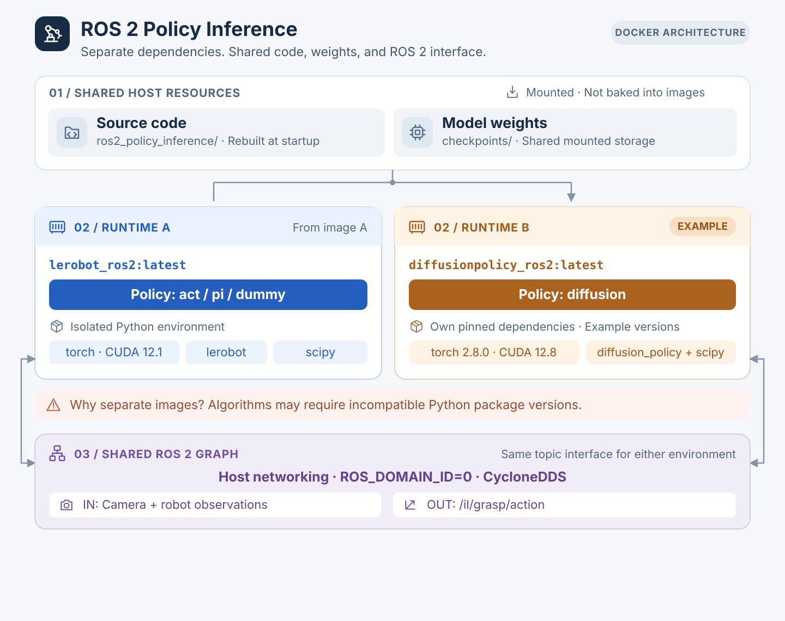

# 🤖 ROS 2 Policy Inference

Run IL / VLA policies with camera and robot observations.
Publish predicted end-effector actions to `/il/grasp/action`.

## 🏗️ Architecture



Each policy's Python dependencies are isolated in its own Docker image, built from a
dedicated Dockerfile (see [Publish a Docker image](#publish-a-docker-image)). Every image
mounts the same source code and checkpoints at container start.
## 🔑 Setup

Get a GitLab token (scope: `read_api`) from your GitLab profile → Access Tokens, then save it once — scripts pick it up automatically:

```bash
printf '%s' 'glpat-...' > ~/.gitlab_token && chmod 600 ~/.gitlab_token
```

## 🚀 Run

> 💡 Start with `dummy` to check inputs and preprocessing without a checkpoint.

### 🐳 Docker

Requires [NVIDIA Container Toolkit](https://docs.nvidia.com/datacenter/cloud-native/container-toolkit/latest/install-guide.html).

```bash
./run_docker.sh --policy-name diffusion
./run_docker.sh --policy-name diffusion bash   # shell instead of launching
```

| Policy | Status | Image | Rate |
|:--|:--|:--|:--|
| `dummy` | no-op placeholder | `lerobot_ros2` | 10 Hz |
| `act` | not implemented | `lerobot_ros2` | 10 Hz |
| `pi` | not implemented | `lerobot_ros2` | 10 Hz |
| `liteflow` | InternVL3-1B + FLOWER, working | `liteflow_ros2` | 10 Hz |
| `diffusion` | LeRobot Diffusion Policy (fan grasp), working | `lerobot_ros2` | 30 Hz |

`run_docker.sh` pulls the image from the GitLab Package Registry if it isn't present locally. Off the
lab network, build it instead (only public sources are needed); `run_docker.sh` then uses the local one:

```bash
docker compose -f docker/docker-compose.yml build policy-inference            # lerobot_ros2
docker compose -f docker/docker-compose.yml build policy-inference-liteflow   # liteflow_ros2
```

### 📦 Checkpoints

Checkpoints live in `checkpoints/` (git-ignored), mounted into the container at `/checkpoints`.
Set `CHECKPOINT_DIR` in the environment or a repo-root `.env` to use another folder.

| Policy | Path | How to get it |
|:--|:--|:--|
| `liteflow` | `checkpoints/liteflow/{step_20000_ema,hf_cache}` | fetched automatically by `run_docker.sh` (needs GitLab access) |
| `diffusion` | `checkpoints/diffusion/fan_grasp_diffusion_v1` | copy the `policy/` folder of the `fan_grasp_diffusion_v1` release bundle |

Each policy's checkpoint path and inference knobs are in `policies/<name>/config.yaml`.

### 💻 Local

Requires ROS 2 Jazzy and the policy's dependencies.

```bash
source /opt/ros/jazzy/setup.bash
colcon build --packages-select ros2_policy_inference
source install/setup.bash
ros2 launch ros2_policy_inference inference.launch.py policy_name:=diffusion
```

### 📡 Check output

```bash
ros2 topic echo /il/grasp/action
```

## 🔌 ROS Interface

### Inputs

| Topic | Message type | Preprocessed observation |
|:--|:--|:--|
| `/camera_L/color/image_raw/compressed` | `CompressedImage` | RGB: `256 × 256 × 3` |
| `/camera_L/depth/aligned_depth_to_color` | `Image` | Depth: `256 × 256`, nearest-neighbor resize |
| `/left_arm/joint_states` | `JointState` | Position: `(6,)`; velocity: `(6,)` |
| `/left_arm/tcp_pose_world` | `PoseStamped` | EE-offset position: `(3,)`; quaternion: `(4,)` |
| `/left_ft/wrench_compensated` | `WrenchStamped` | `[fx, fy, fz, tx, ty, tz]` |

### Output

| Topic | Message type | Format |
|:--|:--|:--|
| `/il/grasp/action` | `Float64MultiArray` | `[dx, dy, dz, drx, dry, drz, gripper]` |

For `diffusion`: position delta in metres and rotation delta as an axis-angle in radians, both in the
world frame (apply the rotation by left multiplication, `R_next = R(drot) · R_now`), one action per
1/30 s; gripper `1` = open, `0` = closed, threshold at `0.5`. Nothing in this repo subscribes to the
topic yet — the consumer that turns actions into arm motion is still to be written.

## 🛠️ Development

### Add a policy

1. Subclass `PolicyModel` in `policies/your_policy.py`; see `policies/dummy_policy.py`. A policy
   with its own checkpoint/settings gets a subpackage with a `config.yaml` instead; see
   `policies/diffusion/`.
2. Define observation and action specs in `policies/base_policy.py`.
3. Register the policy in `policies/__init__.py` through `create_policy()`.
4. If its actions are tied to a fixed control period, set `inference_rate_hz` on the class; the
   node then ticks at that rate instead of `config/params.yaml`'s.

### Publish a Docker image

Rebuild and publish only when a Dockerfile or its dependencies change. Needs
a token with `api` scope (higher than the `read_api` one from Setup) in
`~/.gitlab_token` or `$GITLAB_TOKEN`:

```bash
./push_docker.sh             # act/pi/dummy/diffusion image
./push_docker.sh --liteflow   # liteflow image
```